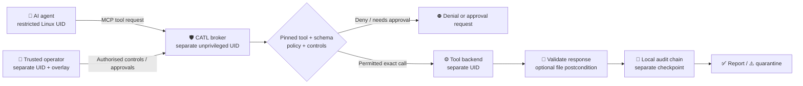

<div align="center">

# 🛡️ CATL — AI Agent Security Gateway for MCP Tools

**Caledapt Agent Trust Layer** · *Give AI agents tools. Keep authority with the operator.*

**A local-first security gateway for AI agents and Model Context Protocol (MCP) tools.**  
**Default-deny policy · Human approval · Rootless Linux broker · Auditable tool execution**


[**Download evaluation source**](docs/GITHUB_SOURCE_PACKAGE_2026-11-09.md) · [**How it works**](#how-catl-works) · [**Try the demo**](#quick-start-local-evaluation) · [**Linux deployment**](docs/DEPLOY_ROOTLESS_LINUX.md) · [**Release notes**](docs/RELEASE_NOTES_PUBLIC_V011.md) · [**Security limits**](#security-boundaries-and-limitations)

Built by **[Caledapt](https://caledapt.com)** in Scotland — *Make AI useful. Not mysterious.*

</div>

> [!IMPORTANT]
> **Status: v0.11.0rc1 — Linux-focused evaluation release candidate; not production-certified.** The project has passed substantial internal Linux tests and a reported four-identity broker demonstration. It has **not** passed production-equivalent host isolation, independent penetration testing, physical FIDO2 authorisation, off-host witnessing, or real provider-side settlement verification. Windows and macOS protected runtimes are not supported. See [acceptance evidence](docs/CATL_ACCEPTANCE_RC_2026-11-08.md) and [open gates](docs/ROADMAP_STATUS_2026-11-07.md).

> **9 November verification update:** 40 source-exact isolated regression cases (including 10,000 deterministic systemd-property negative mutations) passed; a real false-acceptance defect involving unreviewed bind mounts and network namespaces was reproduced and fixed. The pinned six-component evaluation SBOM matched its source, and sanitized service templates passed offline systemd verification. **The full current CATL native checkout was not rerun in this session.** None of the six combined production roadmap gates has been accepted. [Offline acceptance](docs/LOCAL_ACCEPTANCE_2026-11-09.md) · [Mount and namespace correction](docs/MOUNT_NAMESPACE_GUARD_2026-11-09.md).

## Why CATL?

An AI agent might be allowed to *discover* a tool without being authorised to *run* it. Prompt instructions alone cannot establish an operating-system security boundary.

**CATL — Caledapt Agent Trust Layer** is a Python-based, local-first **AI agent tool security gateway**. It mediates supported MCP tool requests through pinned definitions, JSON Schema checks, explicit operator policy, revocable controls and one-use approvals. It records dispatch intents and outcomes in a tamper-evident local audit chain. When a tool's result cannot be verified, CATL can quarantine the uncertain action instead of blindly retrying it.

It is intended for **LLM agent developers**, **MCP server integrators**, and teams evaluating **human-in-the-loop AI tool permissions, action auditing and local AI agent security**.

**CATL is not an LLM, chatbot, antivirus product or universal sandbox.** It protects the tool paths that are actually routed through it. Any alternative tool, shell, plugin or network path must also be restricted by the host's real security configuration.

## How CATL works



In the **protected Linux configuration**, CATL uses distinct broker, agent, operator and backend identities, with Unix sockets and kernel peer-credential checks. The broker keeps its policy, secrets and authorisation state out of the agent process. The overlay runs under the trusted operator identity, not the agent identity.

This separation is meaningful only when the system administrator also restricts direct shell access, network egress, alternate tool registries and filesystem permissions. **A different UID alone does not constitute a complete sandbox.**

## What works today

| Capability | Current implementation and evidence |
|---|---|
| **🔒 Default-deny tool control** | Explicit policy rules, pinned tool definitions, argument schemas and operator-controlled enable/disable switches |
| **✋ Human-in-the-loop approvals** | Exact-action, single-use challenges and signed **software-key** operator authority; replay and Pause/dispatch regression tests |
| **🐧 Rootless Linux broker** | Separate process identities and authenticated agent/operator/backend sockets; tested in a disposable four-UID Linux setup |
| **🖥️ Operator overlay** | Minimisable desktop UI for controls, approvals, pause and uncertain-action review; tested under Xvfb |
| **🧾 Audit and rollback detection** | HMAC-linked local receipts and a separately stored checkpoint; detects database-only rollback, not compromise of both records |
| **⚠️ Fail-closed uncertain actions** | Durable pre-dispatch intent, quarantine after inconclusive effects, no blind automatic replay |
| **🔍 Result and file verification** | Validates supported MCP replies and pinned `outputSchema`; optional local file digest/postcondition checks |
| **🔌 MCP interoperability** | Legacy MCP and an explicitly bounded modern tools-only subset; unsupported methods fail closed |
| **🔏 Release verification tooling** | Source/manifest checks, deterministic archive checks and software-key signature tooling; not independent or hardware-backed provenance |

CATL also includes experimental foundations for WebAuthn assertion checks, a modern upstream adapter, external-effect reconciliation, platform proof checks and a mutual-TLS audit witness. **Those foundations are not claims that physical hardware, Windows/macOS protection, live providers or independently operated witnesses have passed acceptance.**

## See the operator controls


*Actual CATL desktop overlay screenshot using synthetic demonstration state, not a production deployment.* The protected operator UI communicates with the broker through a separate authenticated socket. [Operator signing model](docs/OPERATOR_SIGNING_V011.md) · [Incident recovery](docs/INCIDENT_RECOVERY_V09.md).

## Quick start: local evaluation

**Requirements:** Python 3.11 or later. Use a disposable virtual environment and review the dependencies pinned in [`pyproject.toml`](pyproject.toml).

```bash
# Clone the repository after you have access.
git clone https://github.com/BryanFiFife/CATL.git
cd CATL
python3 -m venv .venv
. .venv/bin/activate
python -m pip install -e .

# Generate the example policy and run the native tests.
python examples/make_policy.py
PYTHONPATH=src python -m unittest discover -s tests -q

# Deliberately UNPROTECTED demonstration (do not use with real credentials).
PYTHONPATH=src python -m catl run \
  --config examples/policy.json \
  --state-dir "$HOME/.catl-demo" \
  --allow-unsandboxed -- python examples/mock_server.py
```

The example reads MCP JSON-RPC requests from standard input; **it does not launch a chat interface**. The `--allow-unsandboxed` option is explicitly an evaluation bypass and is not suitable for consequential or untrusted agent workloads.

### Protected Linux deployment

Protected deployment requires administrator-provisioned OS users, private directories, operator keys, separate backend supervision and correctly configured IPC. **Do not substitute the demo command for a production service.**

Read [Rootless Linux deployment](docs/DEPLOY_ROOTLESS_LINUX.md), [Operator signing](docs/OPERATOR_SIGNING_V011.md), and the [Linux security and acceptance checklist](docs/ROADMAP_STATUS_2026-11-07.md) first. Example systemd service files in [`packaging/systemd/`](packaging/systemd/) remain evaluation templates requiring real-host adaptation and testing.

```bash
# Run as the correctly provisioned broker identity, with real UIDs and paths.
catl doctor --config /etc/catl/policy.json \
  --state-dir /var/lib/catl/state \
  --anchor-path /var/lib/catl-anchor/head.json \
  --agent-uid 10021 --operator-uid 10022 --backend-uid 10023

# Inspect installed units; static templates alone are not proof of confinement.
catl host-audit --broker-unit catl-broker.service \
  --backend-unit catl-backend.service
```

The provided UIDs are examples, not installation defaults.

## Test evidence — what has and has not passed

| Test | Evidence currently available |
|---|---|
| Linux native unittest | **707 discovered; 2 platform-specific skips** in the root/Xvfb run reported by Hermes on 8 November 2026 |
| Pytest | **679 passed, 28 skipped, 426 additional subtests** as reported in the same VM handoff |
| Hermes integration verifier | **22/22** reported |
| Four-identity Linux broker and IPC smoke | **Passed** in a disposable Ubuntu VM, including disarmed/armed/approval-required flows and unauthorised socket denial (reported) |
| Kernel UID/socket isolation matrix | **11/11** reported |
| Production-equivalent Linux systemd/LSM/egress | **Not accepted** — disposable test services were not a completed production hardening evaluation |
| Windows/macOS protected runtime, physical FIDO2, off-host witness and real external provider readback | **Not accepted / not performed** |
| Independent third-party security audit | **Not performed** |

These are developer-run or Hermes-reported results. A previous acceptance document records a different intermediate commit and archive size; the final handoff reports commit `6ccd65009cfb88dc5d4b4c164d9725a98b4cebe5` with a 209-file Git tree. Raw VM logs are not committed in the repo, so this README does **not** claim independent reproduction of that run.

To verify your own checkout and run the existing suite:

```bash
PYTHONPATH=src python -m unittest discover -s tests -p 'test_*.py' -v
python -m pytest tests -q
# An isolated disposable Linux host with administrator privileges is needed for:
# PYTHONPATH=src python tests/integration_rootless_e2e.py
```

[Release-candidate acceptance report](docs/CATL_ACCEPTANCE_RC_2026-11-08.md) · [Offline native acceptance runner](tools/offline_native_acceptance.py) · [Security reporting](SECURITY.md).

## Security boundaries and limitations

- **Mediation, not magic:** CATL cannot stop an agent from using an unmediated shell, plugin or network tool that the host still exposes.
- **Hardware presence is not implemented end-to-end:** current Ed25519 operator grants use software keys. WebAuthn assertion verification alone is not physical enrolment and presence testing.
- **External effects are not automatically proven:** a successful tool reply is not confirmation that an email arrived, a payment settled or an API mutation persisted. Uncertain effects must be reconciled safely.
- **Audit is local first:** a separate local checkpoint detects database-only rollback; independent off-host witnessing remains unverified.
- **Linux-only protected mode:** the full protected broker has not been validated on Windows or macOS.
- **No independent certification:** internal red-team tests are not a substitute for an external penetration test or a hardened production host.
- **High-impact operations:** do not connect unrestricted live payments, email sending, production credentials or other consequential actions without completing the relevant safety and deployment gates.

**Threat-model principle:** the broker cannot secure a host administrator, compromised kernel, stolen operator key or tools outside its enforced boundary. Read [responsible disclosure](SECURITY.md) and the [six-workstream implementation report](docs/SIX_GATE_IMPLEMENTATION_2026-11-07.md) before deploying.

## Roadmap

| Workstream | Current state |
|---|---|
| Production Linux service isolation, egress confinement and real Hermes tool-registry bypass testing | **Incomplete — host-level acceptance required** |
| Hardware-backed FIDO2/WebAuthn approval with one-use credential enrolment and revocation | **Partial primitives only** |
| Windows AppContainer/restricted-token runtime and authenticated named pipes | **Not implemented/accepted end-to-end** |
| macOS sandbox, launchd and peer-authenticated runtime | **Not implemented/accepted end-to-end** |
| Official SDK/transport interoperability beyond the bounded MCP tools subset | **Incomplete** |
| Real provider-specific idempotency, authoritative readback and recovery | **Incomplete** |
| Independently hosted signed witness and externally reviewed release provenance | **Incomplete** |
| Updated SBOM, independent penetration testing, reproducible publication and licensing | **Incomplete** |

The roadmap tracks product engineering and verification separately. See [current roadmap](docs/ROADMAP_STATUS_2026-11-07.md) and [release gates](docs/PRODUCTION_ACCEPTANCE_V09.md). PRs should not claim a security guarantee without code, a reproducer and tests.

## Frequently asked questions

<details>
<summary><strong>Is CATL an AI agent firewall?</strong></summary>

CATL can be described as an **AI agent tool permission gateway** or **MCP security layer**. It denies requests that violate its configured policy and tracks approvals. It is not a universal network firewall or protection for tools that bypass its broker.
</details>

<details>
<summary><strong>Does CATL stop prompt injection?</strong></summary>

No tool layer can guarantee that an agent never follows malicious instructions. CATL is designed to prevent an instruction from becoming an unauthorised **mediated tool action**. Unmediated capabilities remain the deployer's responsibility.
</details>

<details>
<summary><strong>Does it work with Hermes or other MCP-capable agents?</strong></summary>

The repository includes Hermes evaluation integration tests and an MCP tool gateway intended to work with compatible agents. Live, production-hardened Hermes deployment and each agent's effective tool inventory require their own checks.
</details>

<details>
<summary><strong>Is this a secure Windows or macOS application?</strong></summary>

No. Some portable components and platform proof helpers exist, but the protected CATL broker is currently a Linux-focused candidate. Do not claim AppContainer or macOS sandbox enforcement without host-native evidence.
</details>

<details>
<summary><strong>Is CATL open source and free to redistribute?</strong></summary>

**Not under the currently committed licence.** The existing [`LICENSE`](LICENSE) permits private evaluation only and does not grant redistribution, modification or production deployment rights. Free availability and open-source licensing are different decisions. The owner must approve and commit a replacement licence before public redistribution rights can be advertised.
</details>

## Documentation and community

- [Security disclosure policy](SECURITY.md) — report vulnerabilities responsibly; do not publish working exploits against live installations.
- [Rootless deployment guide](docs/DEPLOY_ROOTLESS_LINUX.md) — four-identity Linux architecture and operator setup.
- [Hermes integration](integrations/hermes/README.md) — integration scope and test instructions.
- [Incident recovery](docs/INCIDENT_RECOVERY_V09.md) — uncertain actions and operator reconciliation.
- [Release verification](docs/RELEASE_ATTESTATIONS.md) — source and software signature tooling.
- [Release-candidate evidence](docs/CATL_ACCEPTANCE_RC_2026-11-08.md) — prior VM run and known exclusions.
- [Public evaluation release notes](docs/RELEASE_NOTES_PUBLIC_V011.md) — supported scope, test baseline and distribution caveats.

To discuss reproducible bugs or suggest improvements, use [GitHub Issues](https://github.com/BryanFiFife/CATL/issues). For vulnerabilities, follow [`SECURITY.md`](SECURITY.md) instead of opening a public issue.

## Licence and maintainer

Copyright © 2026 Caledapt. **Private evaluation terms currently apply**; see [`LICENSE`](LICENSE). There is no authorised open-source grant in this revision. A free public distribution decision does not itself override the licence text.

Maintained by **[Caledapt](https://caledapt.com)** · Perth, Scotland 🇬🇧

<div align="center">

**Protect the action. Verify the outcome. Preserve the evidence.**

</div>
