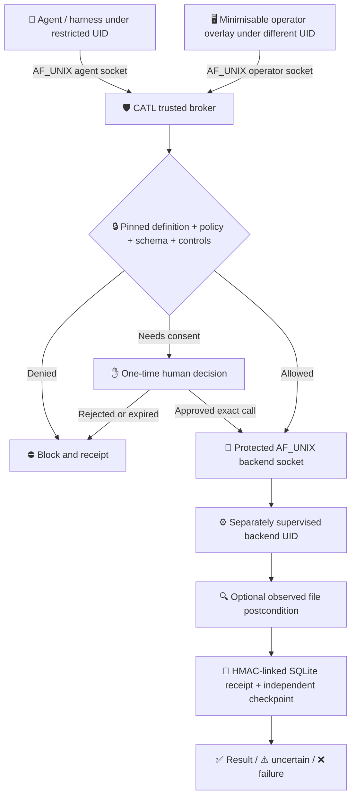
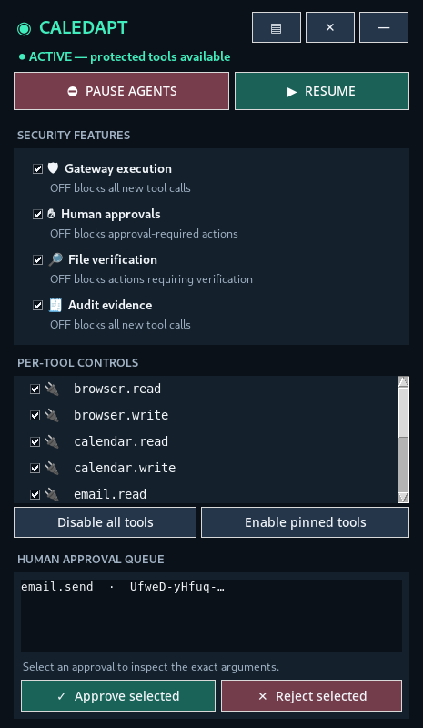

<div align="center">

# 🛡️⚡ CALEDAPT AGENT TRUST LAYER
### Your AI can act. **CATL enforces what it may execute.**

**Local-first · Harness-independent · Default-deny · Human-controlled**


[](https://github.com/BryanFiFife/CATL/actions/workflows/ci.yml)


🇬🇧 Built by **[Caledapt](https://caledapt.com)** · *Make AI useful. Not mysterious.*

**🔒 Private evaluation · 🧪 Linux hardening candidate · 🚫 Not certified or immune to backdoors**

</div>

---

## 🚨 Why CATL exists

Giving an agent a tool does **not** mean it should have permanent authority to use it. CATL sits between an MCP-capable agent and a reviewed downstream tool server. It checks tool definitions, schemas, policy, operator controls, one-time consent and optional observed file postconditions. It records the decision and actual outcome rather than trusting the model to certify itself.

> **Retrieval isn't permission. Intelligence isn't authority. An approval isn't a blank cheque.**

CATL is **not** another agent harness or LLM. A protected Linux broker can now keep keys, policy and approval records away from the agent **and** operate without root, communicating with a separately supervised backend UID.



## 🧪 Release candidate: v0.8.0rc1

**Candidate status: not yet general availability.** Windows protected process isolation,
independent pen testing, full Windows protected execution, full modern MCP conformance and remote
side-effect verification remain unpassed release gates. See
[release gates](docs/PRODUCTION_ACCEPTANCE_V08.md) and [security review](docs/SECURITY_AUDIT_V07.md).

**Previously in v0.7:** hardened policy file ownership, immediate approval revocation when the operator disables a safety feature, and fail-closed validation of untrusted tool replies. The current 2026 MCP `_meta` envelope is checked for the supported stdio subset. `catl host-audit` provides read-only checks of the live Linux systemd service profile; a separate recovery drill proves that database-only rollback is rejected in a disposable environment. [Full notes](docs/RELEASE_NOTES_V07.md).

## 🔐 New in v0.8: Pinned output-contract firewall

CATL now rejects ambiguous MCP result kinds (including `input_required`) as **uncertain, not completed**. If a pinned tool definition declares `outputSchema`, the downstream server's `structuredContent` must match that locally validated JSON Schema before the caller receives a success. Remote `$ref` loading is refused. The original tool's potential side effect is recorded, and CATL **does not automatically retry** a call whose result was unverified.

This is a narrower, testable guarantee—not proof that the external system actually changed correctly or that prompt injection can never occur. See [the v0.8 acceptance checklist](docs/PRODUCTION_ACCEPTANCE_V08.md).

## ✨ What's in v0.8.0rc1?

| Capability | Evidence / limits |
|---|---|
| 🛡️ Default-deny, per-tool enable/disable and pinning | Regression tested |
| ✋ One-time, exact-argument human approvals | Tested against replay and modified rows |
| 🧬 Independent JSON Schema validation | External schema references refused |
| 🛑 Minimisable always-on-top operator overlay | Graphical tests on virtual Linux display |
| 🔐 Distinct Linux agent and operator sockets | Kernel `SO_PEERCRED` validates both configured UIDs |
| 🗝️ Keyless agent shim and broker-controlled desktop client | Agent cannot request operator operations through its MCP socket |
| 🧾 Independent audit checkpoint | Detects DB-only rollback/truncation; deliberately fails closed after crash gaps |
| 🧷 Signed control/approval-row replay fences | Control and consumed-approval receipt history checked |
| 🐧 **New: non-root broker and separately supervised tool backend** | Real four-UID test with separate IPC groups and peer UID enforcement |
| 🧑‍💻 Restricted backend identity and scrubbed environment | Test backend couldn't access broker's protected signing key |
| 🔎 File SHA-256 output verification | Local files only; external business outcomes not verified |
| 🧯 Rate limits, bounded payloads, no shell subprocesses | Included; not a full resource sandbox |
| 🔌 MCP 2025 legacy + 2026-07-28 **tool-only** subset | Full protocol conformance, HTTP and MRTR are not supported |

**What is *not* promised:** no-backdoor guarantee, Windows AppContainer enforcement, independent penetration-test certification, remote payment/email verification, arbitrary network egress blocking or a complete MCP implementation. The protected broker currently supports **Linux only**, and its deployment needs distinct OS users and protected directories.

## 🧭 Before deploying on Linux

`catl doctor` checks policy/state/key/anchor configuration; `catl host-audit` reads **actual active systemd units** and fails if restrictions are missing. Neither can prove the kernel or operator account is uncompromised. Example units are in `packaging/systemd/` and must be adapted, installed and verified on a real host. The `tools/recovery_drill.py` script deliberately damages only synthetic temporary state and must reject an old database when the checkpoint has advanced.

```bash
catl host-audit --broker-unit catl-broker.service --backend-unit catl-backend.service
python tools/recovery_drill.py
```

Never arm high-impact external-effect tools solely because these checks pass. An independent outcomes verifier and host review are still required.

## 🖥️ Minimise it. Control it. Inspect every tool.



*Actual desktop test screenshot (originally captured in v0.3); the current overlay communicates over the protected operator socket without opening the signing key.*

The panel allows users to **pause/resume execution, enable or disable approvals, verification and audit pathways, toggle each pinned tool, bulk-toggle tools, and approve or reject precise actions**. Disabling verification, approvals or audit never creates an unsafe bypass: dependent calls stop instead. The window can minimise to the taskbar or collapse to a compact view.

**Secure deployment:** `catl overlay --operator-socket /run/catl/operator.sock`. The GUI must run as the *trusted operator OS identity*, not as the agent. The legacy direct-state interface remains for explicitly flagged **demonstrations only**.

## 🧪 Fast demonstration (NOT an isolated installation)

```bash
python -m pip install -e .
python examples/make_policy.py
PYTHONPATH=src python -m unittest discover -s tests -q

# Non-isolated demo only, explicitly acknowledged:
PYTHONPATH=src python -m catl run \
  --config examples/policy.json \
  --state-dir "$HOME/.catl-demo" \
  --allow-unsandboxed -- python examples/mock_server.py
```

Running this waits for MCP JSON-RPC input from your harness. It does not start a chat app. The demo mode intentionally **does not** claim security against a same-user compromised agent.

## 🐧 Rootless Linux security: four isolated identities

1. **🛡️ Broker UID:** stores pinned policies, protected key, SQLite approvals and receipt checkpoint; runs as a normal unprivileged service identity.
2. **🤖 Agent UID:** can submit *only* MCP tool requests over its group-traversable agent socket. Kernel peer credentials verify the exact UID, not just the group.
3. **👤 Operator UID:** controls the overlay and approvals over a different operator-only socket. Agent requests never reach the operator API.
4. **⚙️ Tool backend UID:** runs independently under a third protected Unix socket, with a different unprivileged identity. Both ends verify the peer UID. CATL cannot launch an untrusted tool as the broker's own user in protected mode.

No service needs root **during normal operation**. A trusted administrator still provisions accounts, groups, directories and OS service restrictions. The rootless design was tested using four distinct synthetic UIDs and three separate socket groups in a disposable Linux test environment.

**🔧 [Read the rootless deployment guide](docs/DEPLOY_ROOTLESS_LINUX.md).** This includes the startup sequence and required ownership/modes. Misconfigured group access or shared OS identities defeat the intended separation. A restricted UID is not a complete sandbox.

### 🔁 How approval works

`tools/call` on a sensitive tool → `human_approval_required` → operator verifies the arguments in the protected overlay → one-use decision stored and anchored → the agent retries the **same** arguments → a receipt records dispatch and outcome. Any subsequent replay is refused unless separately approved again.

A control change updates the anchored audit history. Restoring an old *validly signed* control row or used approval row no longer silently restores authority.

### 🧷 Why the anchor matters

HMAC alone can authenticate individual receipts but cannot reveal a missing *tail* if both the database and its previous checkpoint are under attacker's control. CATL keeps a second signed head record outside the database directory and requires it to match the verified receipt chain. **A database-only rollback is denied.** If the anchor is deleted, modified, or out of sync after a crash, execution **fails closed** and requires trusted investigation; it does not auto-reset the checkpoint.

This **does not protect** against a broker-account compromise, copying back *both* database and anchor, compromised signing key, kernel compromise, or editing backend and harness outside CATL. A remotely witnessed or hardware-backed monotonic anchor remains future work.

## 🛠️ Test it yourself

```bash
python -m pip install -e .
python -m compileall -q src tests examples
# Desktop test if Xvfb exists (Linux):
xvfb-run -a env PYTHONPATH=src python -m unittest discover -s tests -q
# On a disposable Linux root test environment only (uses synthetic test UIDs):
PYTHONPATH=src python tests/integration_rootless_e2e.py
```

**Evidence:** 203 unit/regression tests passed locally under Linux / Python 3.13.5 with Xvfb, plus a real unprivileged four-UID broker ↔ backend ↔ agent ↔ operator exercise. The root test verified operator-channel denial, tool execution, one-use approval, audit validity and signing-key access denial. GitHub CI [passed 8/8 scoped jobs](https://github.com/BryanFiFife/CATL/actions/runs/42327737185) on commit [`62547af399a4`](https://github.com/BryanFiFife/CATL/commit/62547af399a4c4191a949616ff7431eb5d236015); Windows ran portability/fail-closed tests **only**, not a protected broker. No independent penetration test has been performed.

🧪 [v0.6.0rc1 audit](docs/SECURITY_AUDIT_V06.md) · 🐧 [Rootless deployment](docs/DEPLOY_ROOTLESS_LINUX.md) · 🗒️ [Release notes](docs/CHANGES_V06.md) · 🔐 [Responsible disclosure](SECURITY.md)

## 🪟 Windows and macOS

- **Windows:** the existing unisolated demonstration can be run intentionally, but the v0.6.0rc1 *protected broker* is **not supported**. Before consequential deployment it needs tested AppContainer/restricted-token isolation, secured named-pipe/ACL operator channels, Job Objects, and anti-UI-spoofing controls. Microsoft documents AppContainer as an OS-enforced security boundary.
- **macOS:** direct demo and general policy components can be evaluated, but the current kernel-credential broker transport is Linux-only. macOS identity-pinned transport and sandbox verification remain open work.

Windows references: [Microsoft AppContainer isolation](https://learn.microsoft.com/en-us/windows/win32/secauthz/appcontainer-isolation), [CreateRestrictedToken](https://learn.microsoft.com/en-us/windows/win32/api/securitybaseapi/nf-securitybaseapi-createrestrictedtoken).

## 🌍 Built for eventual interoperability

CATL is designed to complement rather than replace [AgentInterdict](https://github.com/BryanFiFife/AgentInterdict), [MandateLease](https://github.com/BryanFiFife/MandateLease), [EvidenceClock](https://github.com/BryanFiFife/EvidenceClock) and [Assentia](https://github.com/BryanFiFife/Assentia). The named integrations remain a **roadmap**, not installed adapters.

## 🗺️ Roadmap

- [x] ✅ Deterministic policy + schema pinning
- [x] ✅ Human approval with replay protection
- [x] ✅ Keyless Linux agent shim and UID-authenticated operator channel
- [x] ✅ Signed audit checkpoints, database-only rollback detection
- [x] ✅ Desktop overlay with functional toggles and approval queue
- [x] ✅ Dedicated non-root broker with independent backend and kernel UID-bound sockets
- [ ] 🔐 Hardened OS service profiles, capabilities, cgroups and egress restrictions
- [ ] 🪟 Windows AppContainer/restricted-token + named-pipe ACL deployment, real Windows security results
- [ ] 🍎 macOS sandbox and peer-authenticated UNIX socket support
- [ ] 🌐 Full MCP current/legacy interoperability, modern upstream backend and SDK conformance
- [ ] 🧾 Remote API/email/payment read-after-write and idempotent reconciliation
- [ ] 🏛️ Remote/hardware-backed audit anchors, signed reproducible releases, SBOM review and external penetration tests

## 🩺 Broker preflight (Linux)

Run as the *broker* OS account **after** initial state and external checkpoint
provisioning, and before arming any tools:

```bash
catl doctor --config /etc/catl/policy.json \
  --state-dir /var/lib/catl/state \
  --anchor-path /var/lib/catl-anchor/head.json \
  --agent-uid 10021 --operator-uid 10022 --backend-uid 10023
```

Replace example UIDs with the actual distinct host accounts. Output is JSON with
explicit failures and warnings. The `--strict` flag additionally treats unverified
host-isolation assurances as blockers. This diagnostic cannot prove the host is
secure; it never repairs or recreates a missing key or checkpoint.

## ⚖️ Security and licensing

**Private evaluation license.** See [LICENSE](LICENSE). No telemetry, external login requirement, automatic update service or outbound reporting endpoint has been added to this release. Review all dependencies and backend tools before using real data.

Security reports: see [SECURITY.md](SECURITY.md). This is an actively developed engineering prototype, **not a guarantee that an attacker cannot insert a backdoor**.

---
<div align="center">

**🛡️ Protect the action. 🔍 Verify the outcome. 🧾 Keep the evidence.**

**[Caledapt](https://caledapt.com) · Perth, Scotland 🇬🇧**

</div>
