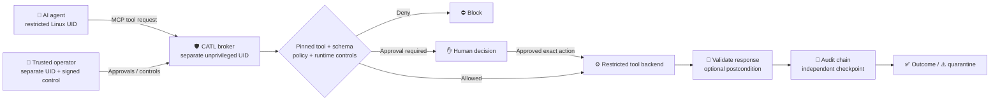

<div align="center">

# 🛡️ CATL — Open-Source AI Agent Security Gateway for MCP Tools

### Give AI agents tools without giving them a blank cheque.

**CATL (Caledapt Agent Trust Layer)** is a local-first security and permission gateway for **AI agents, LLM tools and Model Context Protocol (MCP) servers**.

**Default-deny tool policy · Human approval · Rootless Linux isolation · Signed operator controls · Tamper-evident audit**

[](LICENSE)
[](https://github.com/BryanFiFife/CATL/tree/release/v0.11.0-rc2)


[**Latest rc2 source**](https://github.com/BryanFiFife/CATL/tree/release/v0.11.0-rc2) · [**Install CATL**](docs/INSTALL_LINUX.md) · [**How it works**](#how-catl-works) · [**Security model**](#security-boundaries) · [**rc2 notes**](docs/RELEASE_NOTES_PUBLIC_V011_RC2.md) · [**Report a vulnerability**](SECURITY.md)

Built by **[Caledapt](https://caledapt.com)** in Scotland · *Make AI useful. Not mysterious.*

**If CATL solves a problem you care about, star the repo. It helps other AI-agent builders find it. ⭐**

</div>

> [!IMPORTANT]
> **Current release: v0.11.0rc2 — open-source Linux release candidate.** CATL is licensed under **Apache-2.0**. It has substantial developer-run Linux regression, four-identity broker and installer smoke-test evidence, but it is not an independent security certification. Protected Windows/macOS runtimes are not claimed.

## Why CATL exists

AI agents are increasingly being connected to email, files, databases, browsers, internal APIs, payment systems and MCP servers. The dangerous part is not the language model itself — it is the moment a generated instruction becomes a **real tool action**.

Prompt rules such as *"ask before doing anything dangerous"* are useful UX, but they are not an operating-system security boundary.

CATL puts a separate trust layer between the agent and its tools:

- the agent can discover supported tools without automatically being authorised to execute them;
- exact tool definitions and schemas can be pinned;
- policy is **default deny**;
- sensitive calls can require explicit human approval;
- approvals are bound to a specific action and are one-use;
- the operator, agent and backend can run under separate Linux identities;
- uncertain external effects are quarantined instead of blindly retried;
- dispatch intent and outcomes are written to a tamper-evident local audit chain.

In practical terms, CATL is an **AI agent permission gateway**, **MCP security layer**, **human-in-the-loop approval broker** and **local audit boundary** for tool-using agents.

## The 10-second mental model

```text
AI agent
   │
   │ MCP tool request
   ▼
CATL broker ──► deny
   │
   ├──────────► require human approval
   │
   └──────────► execute exact permitted tool call
                    │
                    ▼
              restricted backend
                    │
                    ▼
          validate + audit outcome
```

The model is deliberately simple: **the agent proposes; CATL decides whether that proposal is allowed to become an action.**

## What CATL gives you

| Capability | What it does |
|---|---|
| 🔒 **Default-deny tool permissions** | Unknown or unapproved tool actions do not silently pass through |
| 📌 **Pinned MCP tool definitions** | Detects changes to reviewed tool definitions instead of trusting names alone |
| 🧩 **JSON Schema validation** | Validates supported tool arguments and responses before they cross the boundary |
| ✋ **Human-in-the-loop approvals** | Supports exact-action approval for sensitive operations |
| ♻️ **Replay protection** | Approved actions cannot simply reuse an old approval indefinitely |
| 🐧 **Rootless Linux broker** | Separates broker, agent and backend service identities in the protected deployment model |
| 🔐 **Signed operator authority** | Protected operator commands can use a separate Ed25519 software signing key |
| 🧾 **Tamper-evident audit** | HMAC-linked receipts plus a separately stored checkpoint detect database-only rollback |
| ⚠️ **Uncertain-effect quarantine** | Avoids dangerous automatic retries when an external side effect may already have happened |
| 🔍 **Postcondition verification** | Optional local verification can check whether an expected file outcome really occurred |
| 🖥️ **Operator overlay** | Minimisable desktop controls for approvals, pause state and incident review |
| 🔌 **MCP interoperability** | Supports the audited legacy path and an explicitly bounded modern tools subset |

## Who CATL is for

CATL is built for people working on:

- **MCP server security** and Model Context Protocol tool permissions;
- **AI agent security** and LLM tool-use controls;
- local or self-hosted AI agents that should not send authority to a third-party control plane;
- human approval workflows for agentic automation;
- AI governance where tool execution needs an auditable decision trail;
- developers integrating agents with files, APIs, browsers, internal systems or other consequential tools;
- security teams evaluating how to separate an AI agent from the credentials and authority of the human operating it.

CATL is **not** an LLM, chatbot, endpoint antivirus product or universal sandbox. It only mediates paths that are actually routed through it. If the agent still has an unrestricted shell, alternate plugin system, direct API credential or unmediated network path, that route remains outside CATL's authority.

## How CATL works



In the protected Linux design, CATL separates the broker, agent and tool backend into distinct identities and uses Unix sockets with kernel peer-credential checks. The broker owns policy and audit authority; the untrusted agent does not.

## See the operator controls


*Actual CATL overlay using synthetic demonstration state.* The protected UI communicates with the broker over its operator channel rather than reading the broker's secret state directly.

## Quick start

### Local development / demonstration

**Requirements:** Python 3.11+

```bash
git clone https://github.com/BryanFiFife/CATL.git
cd CATL

python3 -m venv .venv
. .venv/bin/activate
python -m pip install -e .

python examples/make_policy.py
PYTHONPATH=src python -m unittest discover -s tests -q
```

For an intentionally unprotected local demonstration:

```bash
PYTHONPATH=src python -m catl run \
  --config examples/policy.json \
  --state-dir "$HOME/.catl-demo" \
  --allow-unsandboxed -- python examples/mock_server.py
```

`--allow-unsandboxed` means exactly what it says: it is for a disposable demonstration, not a consequential agent workload.

### Protected Linux installation

The rc2 installer verifies the release manifest before privileged changes, installs CATL into `/opt/catl/venv`, provisions separated service identities and IPC groups, preserves existing state/anchors, renders the reviewed systemd profiles and bootstraps fresh anchored state.

```bash
python3 tools/catlinstall.py --check --source-root .

sudo python3 tools/catlinstall.py --install \
  --source-root . \
  --operator-user "$USER" \
  --operator-public-key /path/to/operator-public.hex
```

Then verify the installed host:

```bash
sudo python3 tools/catlinstall.py --verify-installed \
  --operator-user "$USER"
```

Read the full **[Linux installation guide](docs/INSTALL_LINUX.md)** before installing on a real host.

## Security architecture

CATL's protected Linux deployment is based on four roles:

| Role | Purpose |
|---|---|
| `catl-broker` | Owns policy, audit state, approval authority and independent anchor |
| `catl-agent` | Represents the untrusted AI-agent side of the boundary |
| Human operator | Holds trusted interactive authority and operator signing material |
| `catl-tools` | Runs the restricted tool backend separately from broker authority |

Separate IPC groups gate agent, operator and backend channels. The reviewed systemd profiles use no ambient capabilities, AF_UNIX-only address families, private networking, strict filesystem protections and resource limits.

A different UID alone is not magic. The host still has to prevent the agent from reaching the same capability through another path.

## Test and release evidence

CATL deliberately separates **evidence** from **claims**.

Current public evidence includes:

- **31/31 installer regression tests** for the rc2 installer;
- **1,000/1,000 hostile manifest cases rejected** in deterministic adversarial coverage;
- disposable Linux **install → verify → reinstall** smoke testing with state/anchor preservation;
- rendered broker/backend units passing `systemd-analyze verify`;
- offline systemd security analysis scoring **1.3 / OK** for both reviewed service profiles;
- the rc1 core baseline records **278 passing Linux regressions**;
- a real four-UID signed rootless E2E records forgery denial, tool execution, approval/replay control, audit verification, channel isolation and broker-key denial.

See **[rc2 release notes](docs/RELEASE_NOTES_PUBLIC_V011_RC2.md)** and **[installer acceptance evidence](docs/INSTALLER_ACCEPTANCE_2026-11-09.md)** for the exact scope.

These are developer-run tests, not an external penetration-test certificate.

## Security boundaries

CATL is designed to fail closed where possible, but its boundary is intentionally explicit:

- **Mediated tools only.** CATL cannot control a shell, plugin, credential or network route that bypasses it.
- **Operator compromise remains operator compromise.** A stolen operator identity/key is outside the guarantees of a software approval layer.
- **Current protected runtime is Linux-focused.** Windows AppContainer and macOS sandbox enforcement are not claimed end-to-end.
- **Software signing is not physical presence.** WebAuthn/FIDO2 foundations exist, but current operator approval does not claim completed hardware-presence assurance.
- **External side effects require authoritative reconciliation.** A tool returning `success` does not prove an email arrived, a payment settled or a remote mutation persisted.
- **Local audit is not an independent witness.** The separate checkpoint detects database-only rollback, not an attacker able to rewrite all local trust material.
- **Open source is not security certification.** Review the code, threat model and deployment before connecting consequential tools.

Read **[SECURITY.md](SECURITY.md)** and the **[threat model](docs/THREAT_MODEL.md)** before production deployment.

## CATL vs prompt-only safeguards

| Prompt-only instruction | CATL |
|---|---|
| “Do not use dangerous tools” | Explicit deny/allow/approve policy outside the model |
| “Ask me before sending” | One-use approval bound to the pending action |
| “Only use this schema” | Runtime schema validation and pinned tool definitions |
| “Remember what you did” | Durable local audit receipts and checkpointing |
| “Don’t retry if unsure” | Uncertain-effect quarantine and reconciliation workflow |
| Same process/user as agent | Protected Linux mode separates broker, agent and backend identities |

The goal is not to replace good prompting. It is to make the final authority decision somewhere more trustworthy than the prompt itself.

## MCP and agent integration

CATL is agent-agnostic at the trust-layer level. The repository includes Hermes integration tooling and a keyless MCP shim. Compatible agents can route tool calls through the broker rather than receiving unrestricted tool credentials directly.

Useful starting points:

- [Hermes integration](integrations/hermes/README.md)
- [Architecture](docs/ARCHITECTURE.md)
- [Rootless Linux deployment](docs/DEPLOY_ROOTLESS_LINUX.md)
- [Operator signing](docs/OPERATOR_SIGNING_V011.md)
- [Incident recovery](docs/INCIDENT_RECOVERY_V09.md)
- [Release verification](docs/RELEASE_ATTESTATIONS.md)

## Roadmap

Important work beyond rc2 includes:

- deeper production-host Linux hardening and adversarial deployment testing;
- hardware-backed operator presence and recovery;
- protected Windows and macOS runtimes;
- broader MCP transport / SDK conformance;
- provider-specific authoritative outcome verification;
- independently operated witness infrastructure;
- external penetration testing and reproducible signed release provenance.

See [the detailed roadmap](docs/ROADMAP_STATUS_2026-11-07.md).

## Frequently asked questions

<details>
<summary><strong>Is CATL an AI agent firewall?</strong></summary>

“AI agent firewall” is a useful shorthand, but CATL is more precisely an **AI agent tool permission gateway**. It controls mediated tool execution rather than arbitrary network traffic.
</details>

<details>
<summary><strong>Does CATL stop prompt injection?</strong></summary>

CATL does not promise to stop malicious text from influencing an LLM. Its purpose is to stop an influenced model from automatically turning that instruction into an unauthorised mediated tool action.
</details>

<details>
<summary><strong>Does CATL support MCP?</strong></summary>

Yes. CATL mediates supported Model Context Protocol tool calls, with an audited legacy path and a deliberately bounded modern tools subset. Unsupported behaviour fails closed rather than silently broadening authority.
</details>

<details>
<summary><strong>Can I use CATL commercially?</strong></summary>

Yes. CATL is open source under the **Apache License 2.0**, which permits commercial use, modification and redistribution subject to the licence terms.
</details>

<details>
<summary><strong>Does CATL send my tool authority to a cloud control plane?</strong></summary>

No by design. CATL's trust decisions and audit state are local-first. The tools you connect may of course contact external services according to their own behaviour and your host policy.
</details>

## Contributing

Issues, reproducible bug reports, documentation improvements and security-minded contributions are welcome.

See **[CONTRIBUTING.md](CONTRIBUTING.md)** for the development workflow, **[CODE_OF_CONDUCT.md](CODE_OF_CONDUCT.md)** for community expectations, **[CHANGELOG.md](CHANGELOG.md)** for public release history and **[CITATION.cff](CITATION.cff)** for citation metadata.

- Use **GitHub Issues** for normal bugs and feature proposals.
- Use **[SECURITY.md](SECURITY.md)** for vulnerabilities; do not publish a working exploit against live deployments as a normal issue.
- Include a reproducer and tests for security-boundary changes wherever possible.
- Contributions are submitted under the project's Apache-2.0 licence unless explicitly stated otherwise.

If you build something useful with CATL, **star the repository, link back to it, and tell us what agent/tool stack you integrated**. Real integrations make the project better and help other builders discover safer patterns for agentic AI.

## Licence

Copyright © 2026 Caledapt.

CATL is licensed under the **[Apache License 2.0](LICENSE)**. Commercial use, modification and redistribution are permitted under the terms of that licence. See [`NOTICE`](NOTICE) for attribution information.

Maintained by **[Caledapt](https://caledapt.com)** · Perth, Scotland 🇬🇧

<div align="center">

### Protect the action. Verify the outcome. Preserve the evidence.

**Open-source security infrastructure for tool-using AI agents.**

</div>
